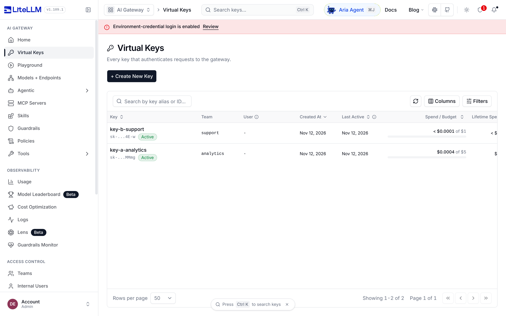
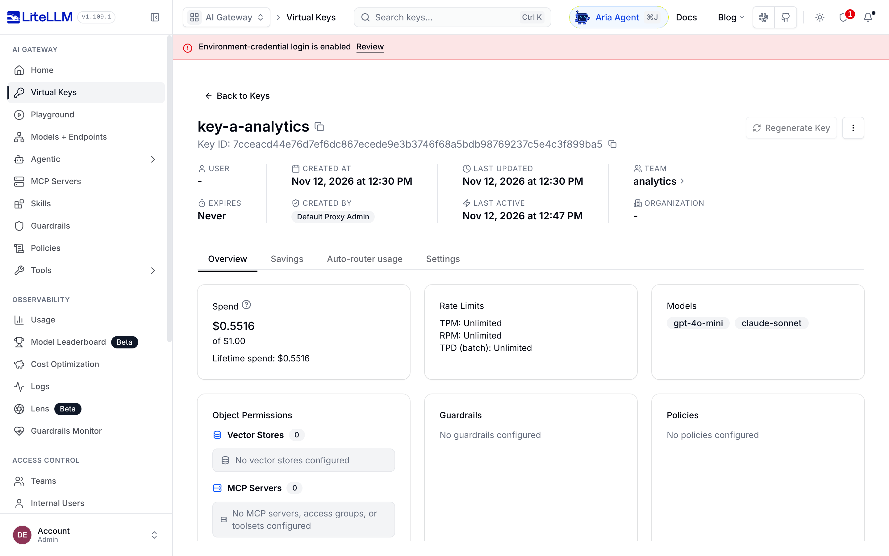
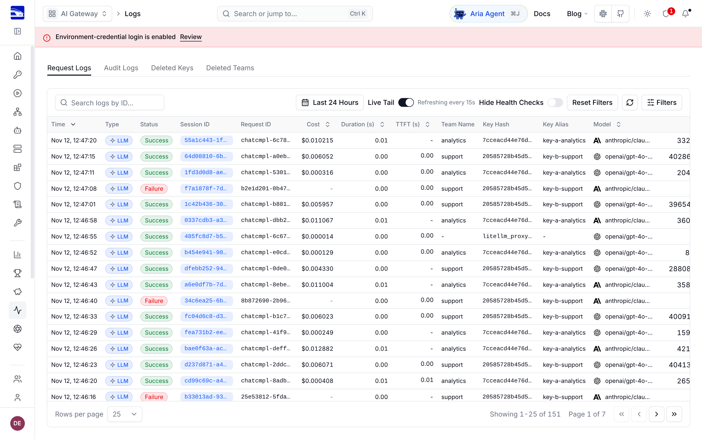
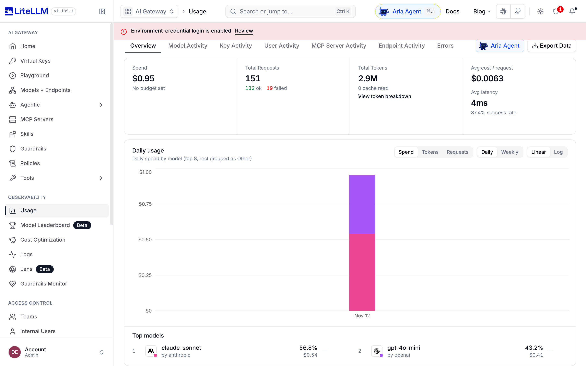

# LLM API Gateway demo (LiteLLM Proxy)

Author: Northkeel Labs (northkeellabs.com)

A small, working demo of a centralized LLM gateway built on the open-source LiteLLM Proxy 1.109.1: one OpenAI-compatible endpoint in front of OpenAI and Anthropic models, virtual API keys with per-key model access, budgets and rate limits, token and cost tracking, request logs, a fallback route, and the LiteLLM admin UI. It runs natively (PostgreSQL from apt, a Python venv, a systemd unit). No Docker.

**Video walkthrough (69 s, voice + captions):** the acceptance test, then the keys, logs and usage pages. GitHub starts videos muted: click the speaker icon in the player to hear the voiceover.

https://github.com/user-attachments/assets/fb4b8e3d-80c2-4a08-9206-39f17259f08a


## Acceptance test: 8 of 8 pass

| Check | Result |
|---|---|
| Key A (team analytics) calls gpt-4o-mini | PASS, HTTP 200 |
| Key A calls claude-sonnet | PASS, HTTP 200 |
| Key B (team support) calls claude-sonnet, not in its allowed models | PASS, refused with HTTP 403 |
| Key B calls gpt-4o, not in its allowed models | PASS, refused with HTTP 403 |
| No key, and a bad key | PASS, both refused with HTTP 401 |
| Key B calls gpt-4o-mini, which it is allowed | PASS, HTTP 200 |
| Spend, tokens and log rows recorded per key | PASS |
| Fallback: primary provider fails, request is answered by gpt-4o-mini | PASS, HTTP 200 |

Full output in [Acceptance test results](#acceptance-test-results) and `test-results.txt`. Run it yourself with `scripts/acceptance_test.py`.

## IMPORTANT: provider calls are mocked

This demo has no paid provider keys. Every model in `config.yaml` uses LiteLLM's `mock_response`, so calls succeed and return a canned string like "Mock reply from gpt-4o-mini via the gateway" without contacting OpenAI or Anthropic. Auth, key restrictions, budgets, routing, fallback, spend tracking, logs and the UI are all real; only the model's answer is fake. For real use, set real `OPENAI_API_KEY` and `ANTHROPIC_API_KEY` in the environment file and delete the `mock_response` lines (and optionally the explicit `input_cost_per_token`/`output_cost_per_token` lines, since LiteLLM then uses its built-in price table).

Cost tracking note: mocked calls log zero cost by default, so `config.yaml` sets `input_cost_per_token` / `output_cost_per_token` per model (approximate public list prices) so spend is non-zero in the demo.

## Architecture

```
client / app --(Bearer virtual key)--> [Caddy/nginx TLS] --> LiteLLM Proxy :4000 --> OpenAI / Anthropic
                                                              |
                                                              +--> PostgreSQL (keys, teams, spend, request logs)
                                                              +--> Admin UI at /ui
```

- `config.yaml`: models (`gpt-4o-mini`, `claude-sonnet`, `gpt-4o`), a fallback route `resilient-chat` (primary is a deliberately failing mock, falls back to `gpt-4o-mini`), and general settings (master key and DB URL from env).
- Keys: A = team "analytics", models gpt-4o-mini + claude-sonnet, budget $1. B = team "support", gpt-4o-mini only, budget $1, 10 requests/minute.

## Install (Ubuntu 22.04/24.04, native)

```
sudo deploy/install.sh
```

The script installs PostgreSQL from apt, creates the `litellm` DB and user, creates a venv under `/opt/llm-gateway`, pins `litellm[proxy]==1.109.1`, generates a `.env` with random secrets, runs `prisma generate`, installs `deploy/litellm.service` and enables it. Note: the Prisma engines are downloaded automatically on a normal server (the script needs outbound HTTPS to binaries.prisma.sh). In the sandbox this demo was built in that host was blocked, so the engine binaries were supplied manually via the `PRISMA_*_BINARY` environment variables; nothing in the repo depends on that.

Manual run (what was done for this demo):

```
python3 -m venv .venv && .venv/bin/pip install "litellm[proxy]==1.109.1" prisma
cp .env.example .env   # fill in
set -a; . ./.env; set +a; export PATH=$PWD/.venv/bin:$PATH
prisma generate --schema .venv/lib/python3*/site-packages/litellm/proxy/schema.prisma
litellm --config config.yaml --port 4000     # applies DB migrations on first start
scripts/create_keys.sh                        # writes .keys.env (git-ignored)
python3 scripts/seed_traffic.py               # ~80 varied calls so spend, logs and usage have data
python3 scripts/acceptance_test.py | tee test-results.txt
```

TLS: see `deploy/Caddyfile.example` or `deploy/nginx.conf.example`. Keep LiteLLM bound to 127.0.0.1 behind the proxy.

## Runbook

- Restart: `sudo systemctl restart litellm`; logs: `journalctl -u litellm -f`; health: `curl localhost:4000/health/liveliness`.
- Add a provider or model: add an entry under `model_list` in `config.yaml` (e.g. `model: openai/...`, `anthropic/...`, `azure/...`) with `api_key: os.environ/<VAR>`, put the key in `.env`, restart.
- Add a user/key: admin UI > Virtual Keys > Create New Key, or `POST /key/generate` with the master key (see `scripts/create_keys.sh`). Useful fields: `models`, `team_id`, `max_budget`, `budget_duration`, `rpm_limit`, `tpm_limit`, `duration`.
- Rotate a key: `POST /key/{key}/regenerate` (master key) or use Regenerate in the UI. Rotate the master key by editing `LITELLM_MASTER_KEY` and restarting. Do not change `LITELLM_SALT_KEY` after keys exist (it encrypts stored credentials).
- Read spend: `GET /key/info?key=...`, `GET /spend/logs?api_key=...`, `GET /spend/tags`, or the UI Usage and Logs pages. Spend is flushed to the DB by a background task, so it can lag by several seconds.
- Log retention: request logs live in the `LiteLLM_SpendLogs` table. Set `general_settings: maximum_spend_logs_retention_period: "30d"` in `config.yaml` to prune automatically, or delete old rows in PostgreSQL yourself. Back up the DB with `pg_dump litellm`.

## Acceptance test results

Output of `scripts/acceptance_test.py` against the running proxy (also in `test-results.txt`):

```
TEST                                       RESULT  DETAIL
---------------------------------------------------------------------------------
a) key A -> gpt-4o-mini allowed            PASS    HTTP 200: 'Mock reply from gpt-4o-mini via the gateway'
b) key A -> claude-sonnet allowed          PASS    HTTP 200: 'Mock reply from claude-sonnet via the gateway'
c) key B -> claude-sonnet refused          PASS    HTTP 403
d) key B -> gpt-4o refused                 PASS    HTTP 403
e) no key / bad key refused                PASS    no key HTTP 401, bad key HTTP 401
   key B -> gpt-4o-mini allowed (sanity)   PASS    HTTP 200
f) key A spend > 0, logs + tokens visible  PASS    spend=$0.50091075, log rows=49, total tokens=218607, models=['anthropic/claude-sonnet-4-5', 'openai/gpt-4o-mini']
g) fallback resilient-chat -> gpt-4o-mini  PASS    HTTP 200: 'Mock reply from gpt-4o-mini via the gateway'

OVERALL: PASS
```

Refusals return 403 for a valid key that lacks access to the model and 401 for a missing or invalid key.

## Screenshots (admin UI, v1.109.1)

Taken after `scripts/seed_traffic.py` sent about 150 calls through the gateway (mocked replies, list-price costs), so the numbers are not empty. Times in the UI are UTC.

**Virtual keys.** Each key belongs to a team and has a budget; the bar shows spend against it (key B $0.40 of $1, key A $0.55 of $1).



The red banner is LiteLLM warning that the admin login uses a username and password from the environment file. That is fine for a demo; for production use SSO or keep the admin UI behind your VPN (see Limitations).

**One key in detail.** Key A may call only gpt-4o-mini and claude-sonnet, and has spent $0.55 of its $1 budget.



**Request logs.** Every call with its team, key, model, cost and tokens. The "Failure" rows are key B asking for claude-sonnet, which it is not allowed to use, and being refused with HTTP 403. The row with no team or key alias is the fallback test, sent with the admin master key.



**Usage.** Total spend, requests (successful and refused) and tokens, with daily spend split by model.



## Limitations

- Provider calls are mocked (see top). Real latency, streaming behaviour and provider errors are not exercised.
- The UI shows a red banner "Environment-credential login is enabled" because the admin login uses `UI_USERNAME`/`UI_PASSWORD` from env; LiteLLM suggests SSO for production.
- Enterprise vs open-source features: nothing in this demo needed a licence. For SSO, audit-log retention, per-team guardrails and similar, check LiteLLM's current licence split rather than relying on this README.
- Single instance, no HA, no automated backups, no rate limiting at the TLS layer.
- The fallback test uses the master key because key A is restricted to its two models.

## Files

`config.yaml`, `.env.example`, `scripts/` (create_keys.sh, seed_traffic.py, acceptance_test.py, screenshots.py), `deploy/` (install.sh, litellm.service, Caddyfile.example, nginx.conf.example), `test-results.txt`, `screenshots/`, `LICENSE` (MIT, covers our own files; LiteLLM has its own licence).
